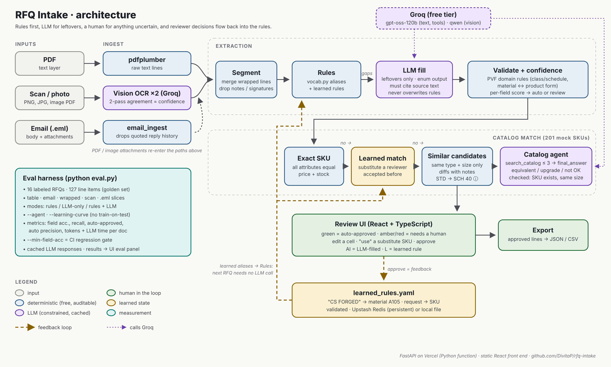

# RFQ Intake

Turn an industrial PVF (pipe, valves, fittings) RFQ — PDF, scan, photo or email (`.eml`) — into structured, priceable line items matched to catalog SKUs. Every field carries a confidence score, domain validation runs on every line, and a human reviews anything uncertain. Reviewer decisions feed back into the rules, so the system needs the LLM less over time.

**Live demo:** [rfq-intake-xi.vercel.app](https://rfq-intake-xi.vercel.app/): click a sample RFQ, or upload a PDF, scan or `.eml`.

## The problem

Inside sales gets RFQs as PDFs, scans and email bodies. Someone re-keys each line ("4" WN FLG 300# RF A105, 8 EA") into the quoting system. Fully automating this is risky, because one wrong class or material means a wrong quote. The goal is to auto-approve only what is provably clean and send everything else to a fast human review.

## The question I wanted to answer: where should the LLM sit?

I built three pipelines over the same validation and scoring and measured them against the same labeled set:

| Mode | What it does |
|---|---|
| **Rules** | Deterministic parsing with a domain vocabulary. No LLM. |
| **LLM only** | The whole document goes to the LLM with a strict JSON schema. No rules. |
| **Rules + LLM** | Rules first. The LLM fills only fields the rules couldn't, resolves generic materials ("316 SS" on a BW fitting becomes A403-WP316L), and flags any field where it disagrees with the rules. |

16 RFQs, 127 labeled line items. Text model: `openai/gpt-oss-120b`; vision model: `qwen/qwen3.8-27b` (both on Groq).

| Mode | Field acc. | Item recall | Auto-approved | Auto precision | Tokens / doc | LLM s / doc |
|---|---|---|---|---|---|---|
| Rules | 80.9% | 82.7% | 88.6% | 100% | 0 | 0 |
| LLM only | 96.1% | 100% | 0%* | — | 3,366 | 4.4 |
| **Rules + LLM** | **99.8%** | **100%** | **90.6%** | **100%** | 2,143 | 2.0 |

| Field accuracy by slice | Rules | LLM only | Rules + LLM |
|---|---|---|---|
| Clean tables | 100% | 93.0% | 100% |
| Email with buyer shorthand | 93.3% | 98.2% | 99.6% |
| Wrapped descriptions | 100% | 94.6% | 100% |
| Scans | 0% (no LLM) | 98.1% | 100% |
| `.eml` with PDF attachment | 98.6% | 100% | 98.6% |

\*By design: a value only the LLM produced can't be checked against anything, so it always goes to a human.

**What this shows:**
- **The rules can't read shorthand or scans.** That's where the LLM earns its cost.
- **The LLM alone makes mistakes on clean tables where the rules are perfect** (93% vs 100%), and nothing flags those mistakes.
- **The hybrid gets the best of both.** It has the highest accuracy, and 9 in 10 items skip review with zero wrong auto-approvals. It does this with about 36% fewer tokens and 55% less LLM time than LLM-only, because the LLM only sees what the rules couldn't handle.
- **Not a clean sweep:** on the `.eml` sample, the hybrid missed one field that LLM-only got. That field was never auto-approved; it went to review.

**Auto precision** is the share of items that skipped review and were fully correct. It is the safety number, and it must stay near 100% while coverage climbs.

## Design

**Rules first.** RFQ text is formulaic. `vocab.py` normalizes the aliases buyers use into one canonical value:
- `2"` / `2 IN` / `NPS 2` / `DN50`
- `150#` / `CL150` / `CLASS 150`
- `A234 WPB` / `WPB`

The rules are deterministic, free, instant and auditable.

**The LLM is constrained, not trusted.**
- Every output field is an enum drawn from the same vocabulary, and anything outside it is dropped.
- The LLM never overwrites a rule-parsed value. When it disagrees with one, the field is flagged for review instead.
- LLM-filled fields score below the review threshold, so the LLM pre-fills and a human confirms.

**Validation encodes PVF domain knowledge:**
- Schedule applies to pipe and BW fittings; pressure class applies to flanges, valves and forged fittings.
- Forged fittings must be 2000/3000/6000.
- Material must match the product form: A105 is forged, A234 is BW fittings, A106 is pipe.
- End connection must fit the category; unit of measure must fit the item.

**Scans use the same pipeline with a different entry point.**
- A vision model transcribes the page twice (temperature 0 and 0.4).
- Vision models don't expose token confidences, so line confidence is the token-level agreement between the two passes.
- That confidence multiplies into every field parsed from the line. An unstable line (blur, skew) drops below the review threshold even when it parses.

**Email in, one pipeline.** `.eml` files are split into the body (plain text, or HTML converted to text) and their PDF and image attachments, and each part goes through the same steps.
- Every line item records where it came from (✉ body or 📎 the attachment's file name).
- Quoted reply history (`> …`, "On … wrote:") is dropped, so last month's order isn't quoted again.
- Unsupported attachments are listed as warnings, not silently ignored.

**Segmentation was the real bottleneck, not field parsing.**
- Wrapped descriptions get merged into one item.
- Notes, signatures and blank-line paragraph breaks end an item.
- A line with a quantity but an unrecognized type is still surfaced as a review item rather than silently lost.

The eval made the problem obvious: on wrapped RFQs, item recall was 100% but auto-approval was 21%. After segmentation was fixed, auto-approval rose to 100%.

## Catalog match and the feedback loop

Extraction answers "what did they ask for?". Quoting needs "which SKU do we ship?". After extraction, each line goes through these steps:

1. **Exact match** against the catalog on the canonical attributes. Deterministic and free.
2. **Learned match:** a substitute a reviewer accepted earlier for the identical request.
3. **Similar candidates.** These must keep the same item type and size, never another size, and each one shows its differences with an engineering note:
   - `STD → SCH 40` ⓘ "same wall thickness up to NPS 10"
   - `RF → RTJ` ⓘ "not interchangeable"
4. **Catalog agent,** only for lines still unresolved after steps 1–3.
   - The LLM gets one tool, `search_catalog(filters)`, with a budget of at most 3 searches, then answers through a `final_answer` call.
   - It returns a verdict: `equivalent`, `upgrade`, `not_acceptable` or `no_match`, with a one-line reason.
   - Its pick is checked: the SKU must exist and must keep the requested type and size.
   - A substitution is a pricing and compliance decision, so the agent's verdict is always a suggestion and a reviewer decides.

**Reviewer decisions become rules.** When the LLM fills a field, it must cite the exact text it read (for example, `"CS FORGED"` read as material `A105`), and that citation is checked against the line.

When a reviewer approves the row, or corrects the value, two things are written to `learned_rules.yaml`:
- the confirmed `text → field = value` pair
- any substitute SKU they picked

The parser loads those rules, so the next RFQ that says "CS FORGED" is handled by rules, with no LLM call. The file is plain YAML, so it can be reviewed in a pull request or edited by hand. Every entry is validated against the vocabulary and the catalog before it's stored.

**Results on the eval set:**
- **Catalog:** 97 of 127 lines matched an exact SKU; the other 30 got similar candidates, and the agent reviewed all 30.
- **Learning curve:** on the four email RFQs, a reviewer confirmed 8 rules. The third email then needed **0 LLM calls**, down from 3, and 12 of its 12 lines were auto-approved because it reused shorthand the first two had taught.
- **Honest limit:** the fourth email used new shorthand, so it still needed the LLM. The loop pays off where buyers repeat themselves, which real customers do far more than 4 synthetic emails can show.

`python eval.py --learning-curve` simulates the loop. It processes the documents in order with a reviewer who confirms correct LLM fields. Learning from document *i* only affects documents after *i*, so nothing is tested on data it learned from. The UI's eval panel charts the resulting LLM calls per document. The main eval runs with learned rules turned off.

**Where the rules are stored:**
- **Upstash Redis** (free tier) when it's configured: persistent and shared by every serverless instance.
- **A local file** in development.
- **`/tmp`** on Vercel without Redis. That copy is temporary, and the UI says so.

## Architecture



| Path | What |
|---|---|
| `backend/app/vocab.py` | Domain vocabulary: types, sizes, schedules, classes, ASTM specs and the product forms each covers |
| `backend/app/parse.py`, `segment.py` | Deterministic field extraction and line-item segmentation |
| `backend/app/validate.py`, `confidence.py` | Domain rules, per-field scoring, auto/review decision |
| `backend/app/llm.py`, `llmclient.py` | Constrained LLM fill, LLM-only baseline; stdlib client for Groq / OpenRouter / OpenAI / Gemini with disk cache, pacing, retries, fail-fast on exhausted quota and usage metering |
| `backend/app/ocr.py` | Vision transcription with self-agreement confidence |
| `backend/app/email_ingest.py` | `.eml` parsing: body, attachments, quoted-history stripping |
| `backend/app/catalog.py`, `data/catalog.csv` | Mock 201-SKU catalog; exact, learned and similar matching with equivalence notes |
| `backend/app/agent.py` | Bounded tool-calling catalog agent with guardrails |
| `backend/app/rules_store.py` | Learned rules as YAML (Upstash, file or /tmp), validated feedback |
| `backend/app/main.py` | FastAPI: `POST /api/extract?mode=`, `GET /api/health`, `GET /api/rules`, `POST /api/feedback`, `POST /api/rules/reset` (admin token); 10 MB cap, rate limits, result cache keyed by rules version |
| `backend/eval.py` | Regression eval across all three modes, plus catalog and learning-curve runs |
| `frontend/` | React + TypeScript review UI. Samples are precomputed static JSON, so the first click is instant with no cold start |

## Eval set

16 synthetic RFQs with 127 line items, generated from canonical items so the ground truth is exact:

| Slice | Docs | What it tests |
|---|---|---|
| table | 5 | Clean tabular RFQs |
| email | 4 | Free text; about half the lines use buyer shorthand the rules don't know (`3K`, `#150`, `S/O`, `EL 90`, `106B`, `two inch`) |
| wrapped | 3 | Descriptions wrapped onto a second line |
| scan | 3 | Blurred, rotated, noisy images and image-only PDF |
| eml | 1 | A real `.eml`: free-text body with shorthand, a PDF line-list attachment, a quoted earlier thread whose old items must be ignored, and an unsupported `.dwg` attachment |

```bash
cd backend
python eval.py                                                      # rules only, no key needed
GROQ_API_KEY=... python eval.py --mode all --export ../frontend/public
python eval.py --mode rules+llm --agent --export ../frontend/public  # catalog agent results
python eval.py --learning-curve --export ../frontend/public          # feedback-loop simulation
python eval.py --min-field-acc 0.9                                  # CI gate
```

LLM responses are cached in `backend/.llm_cache.json`. Once that file is committed, anyone can reproduce the numbers without a key.

**Caveats:**
- The sample generator and the parser share a vocabulary, so the clean-table numbers are optimistic.
- The email-shorthand, scan and `.eml` slices are where real-world difficulty shows.
- The next step is a held-out set of real, anonymized RFQs.

## Run locally

Requires Python 3.10+ and Node 18+.

```bash
cd backend && python -m venv .venv && source .venv/bin/activate
pip install -r requirements.txt
pytest -q && python eval.py
GROQ_API_KEY=... RFQ_LLM=1 uvicorn app.main:app --reload --port 8000

cd ../frontend && npm install && npm run dev   # http://localhost:5173 (proxies /api to :8000)
```

## Next steps

- **Real catalog and live pricing:** swap the mock CSV for the ERP catalog and live price and availability.
- **Real traffic:** run it on a held-out week of real RFQs and grow the eval set from reviewer decisions.
- **Rule governance:** require a second reviewer for learned rules before they apply to everyone, and add an expiry.
- **Learning from edits without evidence:** let the reviewer highlight the source text when they correct a field the LLM never filled.
- **Live inbox connection** (IMAP / Microsoft Graph); `.eml` files are already supported.
- **Thread-aware replies:** resolve "make the 1/2 90s 80 not 50" against the parent email via `In-Reply-To`.
- **More inputs:** multi-page tables, Excel RFQs, handwritten markups.

## How this was built

Built with Claude as an AI pair-programmer.